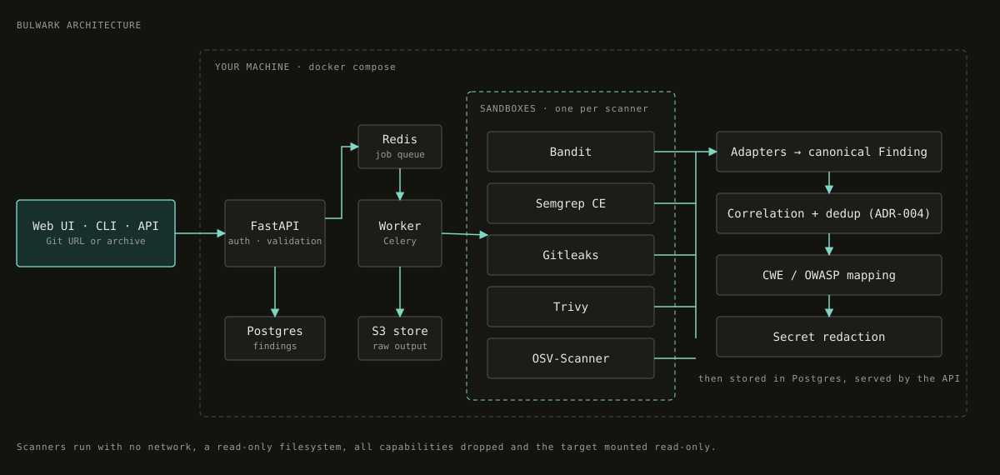

# Bulwark

**Find, merge and manage security findings from every scanner and report, in one place.**

[](https://github.com/rago12bit/cybernatics/actions/workflows/ci.yml)
[](https://securityscorecards.dev/viewer/?uri=github.com/rago12bit/cybernatics)
[](LICENSE)

Bulwark runs open-source scanners against your code in locked-down containers, imports the reports
of tools it doesn't run, merges the duplicates, and gives you one list of Issues per project to
triage, assign, accept, fix and report on, with the evidence of every tool behind each one.

**Documentation:** <https://rago12bit.github.io/cybernatics/> · **Latest release:**
[3.1.0](docs/release-notes-v3.1.0.md) · **Changes:** [CHANGELOG.md](CHANGELOG.md)

> **Status, honestly.** Version 3.1.0. Every feature in the plan is built and tested, and CI runs
> it against real scanners, Postgres, ZAP, Nuclei, Sigstore and Keycloak. What has not happened yet:
> **no usability study with real users**, **no measurement of AI fix quality** (no model has been
> run), and the GitHub App and commercial identity providers (Google, Entra ID, Okta) have only been
> exercised against stand-ins. [What is and isn't measured](#evidence) is below.

## What it does

| | |
|---|---|
| **Scan** | Five scanners by default (Bandit, Semgrep CE, Gitleaks, Trivy, OSV-Scanner), six more on request (Grype, Checkov, gosec, Dockle, Opengrep, Syft). Each runs with no network, a read-only filesystem, no capabilities and resource limits. Unchanged files are served from a cache. |
| **Import** | 14 report formats (SARIF, CycloneDX, SPDX, OSV, ZAP, Nuclei, Burp, Nessus, OpenVAS, Grype, Trivy, Snyk, GitLab, Checkov), plus a mapper for any JSON, CSV or XML. Reimporting reports what is new, unchanged, reopened and closed; the last import can be undone. Parsing happens in the same sandbox. [Guide](docs/ingest-api.md) |
| **Merge** | Duplicates across tools and imports become one Issue with every tool's evidence, mapped to CWE and the OWASP Top 10, ranked by severity, EPSS, CISA KEV and whether your code reaches the vulnerable code. [Risk score](docs/risk-score.md) · [Reachability](docs/reachability.md) |
| **Manage** | One Issues list across every project, with a query language, saved views and bulk changes; owners, SLAs, risk acceptance with approvals, notes and mentions, retests, engagements for pen tests, rules that act on events. [Issue search](docs/issue-search.md) |
| **Know your exposure** | A component inventory, advisories matched against it, VEX statements with evidence, compliance mappings. [VEX](docs/vex.md) · [Compliance](docs/compliance.md) |
| **Report** | Dashboards, a report builder with scheduled and shared reports, PDF/HTML/SARIF exports. [Reports](docs/reports.md) |
| **Test running apps** | DAST with ZAP and Nuclei against web targets you've proved you own, through an egress proxy that only reaches that one host. [ADR-0035](docs/adr/0035-dast-scanning.md) |
| **Fix** | A verified-fix agent proposes a patch, re-runs the scanners and your tests, and opens a pull request only after a person approves; `/fix` on a pull request does the same for what that PR introduced. [Verified fixes](docs/verified-fix-agent.md) · [/fix](docs/fix-on-pull-requests.md) |
| **Work where you are** | A GitHub Action that comments only what a PR introduces, a pre-commit hook, a VS Code extension, an MCP server for your own AI assistant, DefectDojo/Jira/GitHub Issues connectors, Slack/Discord/webhook notifications. [Action](docs/github-action.md) · [MCP](docs/mcp.md) |
| **Run it for a team** | Organizations isolated by Postgres row-level security, sign-in with OIDC or SAML, SCIM provisioning, roles per organization, business unit and project, scoped API tokens, plugins for scanners you add yourself. [Sign-in and roles](docs/identity.md) · [Plugins](docs/plugins.md) |

## Quickstart

Needs Docker with Compose. The first build downloads the scanners' vulnerability databases (about
1.4 GB for Trivy).

```bash
./scripts/init-env.sh                       # writes .env with random secrets
docker compose --profile scanners build     # the app and the scanner images, built here
docker compose up -d
```

Open **http://localhost:3000**: the first page is a sample report. To scan your own code, go to
**/app** and use the API token from `.env` (`BULWARK_API_TOKEN`), or make yourself the first admin
and sign in with your identity provider ([how](docs/identity.md#the-first-admin)):

```bash
bulwark users add --org-id 00000000-0000-0000-0000-000000000000 --email you@example.com --role admin
```

Just the CLI, no server:

```bash
pip install -e ".[dev]"
bulwark scan https://github.com/OWASP/NodeGoat              # or a directory, or a .zip/.tar.gz
bulwark scan . --format sarif -o results.sarif              # also html, pdf
bulwark precommit install                                   # block secrets before they're committed
```

In GitHub Actions ([inputs and behaviour](docs/github-action.md)):

```yaml
- uses: actions/checkout@v4
- uses: rago12bit/cybernatics@main   # pin a release tag or commit SHA
```

More in the [quickstart](docs/quickstart.md) and the [API reference](docs/api.md).

## How it works



A FastAPI service and Celery workers over Postgres 16 (with pgvector and forced row-level security),
Redis, an S3-compatible object store and OpenBao for keys; the web app is Next.js. Scanners run as
one container per tool:
`--network=none --read-only --cap-drop=ALL --user=10001 --security-opt=no-new-privileges`, with
memory, CPU and process limits and the code mounted read-only. The fix agent's long-running work runs
on Temporal. Every design decision is an [ADR](docs/adr/).

## Security

- **Tenant isolation in the database**, not only the app: every table is filtered by Postgres
  row-level security, and people limited to some projects run as a database role that cannot see the
  others. Tested against real Postgres on every push.
- **Untrusted input stays in the sandbox:** scanner output and uploaded reports are parsed in the same
  locked-down container; XML entity tricks, oversized and truncated files are refused. Parsers are
  fuzzed nightly.
- **Supply chain:** every image is built here or pinned by digest and kept current by Dependabot;
  every scanner is built here, from signature-checked releases or from Go source checked against Go's
  checksum database, and upstream images whose publishers sign are verified in CI; Bulwark's own
  images are never pulled; plugins run only the image whose Sigstore signature was verified; GitHub
  Actions are pinned by SHA.
- **Secrets:** raw scanner output is envelope-encrypted per organization and can be crypto-shredded;
  service connections to Postgres use client certificates.

Read the [threat model](docs/THREAT-MODEL.md) (including what is still open), the [OWASP ASVS Level 2
self-assessment](docs/ASVS-SELF-ASSESSMENT.md) and [SECURITY.md](SECURITY.md) to report a
vulnerability.

## Evidence

Every number has a script and a committed result. The full table, including what doesn't flatter
the project, is in [docs/evaluation-v3.md](docs/evaluation-v3.md) (earlier versions:
[v1](docs/evaluation.md), [v2](docs/evaluation-v2.md)).

**Measured:**

- **Report parsers:** 156 of DefectDojo's own sample reports across 10 parsers all parse and agree
  with DefectDojo's expected results, apart from 12 recorded differences and 2 deliberate refusals.
- **Advisory matching:** agrees with osv-scanner on 21,619 of 21,721 package versions; each of the
  102 differences is explained.
- **Speed:** dashboards answer in under 300 ms at p95 over a million findings; Issue search at 100,000
  Issues in under 100 ms; Nessus imports at about 2,400 findings a second.
- **Security tests:** 13 of 13 SAML attacks refused, each for its own reason; parsers fuzzed with no
  crash or hang.

**Not measured yet:**

- **Usability:** no study with real users has run ([docs/ux-study.md](docs/ux-study.md)).
- **AI quality:** verified fixes, `/fix` and the triage assistant have never run against a real
  model.
- **VEX proposals:** the blind review of 100 proposals hasn't happened.
- **Deduplication accuracy:** needs hand-labelled duplicate pairs. The study is built and waits for
  labels ([docs/evaluation-merge-accuracy.md](docs/evaluation-merge-accuracy.md)).
- **Firecracker** for the fix agent's test runs is built but has never run: it needs Linux with KVM.
  The DefectDojo round trip and PDF rendering are tested by hand, not in CI.

## Repository

| Path | What |
|---|---|
| `core/` | scanning, parsing, merging, issues, rules, identity, DAST, the fix agent |
| `api/` | the FastAPI service |
| `cli/` | the `bulwark` command |
| `web/` | the Next.js web app and the public site |
| `docker/` | one Dockerfile per scanner and service image |
| `migrations/` | Alembic migrations (Postgres 16 or later) |
| `tests/` | unit tests (SQLite) and integration tests (real Postgres, scanners, Keycloak, ZAP, Nuclei) |
| `action/`, `extensions/vscode/`, `helm/`, `examples/` | the GitHub Action, the VS Code extension, the Helm chart, an example plugin |
| `docs/` | the documentation site, ADRs, verification records |
| `benchmarks/` | benchmark scripts and committed results |

## Development

```bash
pip install -e ".[dev]"
ruff check . && black --check . && mypy        # what CI runs first
pytest                                          # unit tests; integration tests skip without their services
cd web && npm ci && npm test && npm run typecheck
pip install -e ".[docs]" && mkdocs serve        # the documentation site
```

Integration tests run against real services when they're available: set
`BULWARK_RLS_TEST_DATABASE_URL` for Postgres (see `.github/workflows/ci.yml` for the exact setup),
build the scanner images for the Docker tests, and `BULWARK_KEYCLOAK_URL` for sign-in. CI runs all of
them, on pinned runners and images.

Commits follow [Conventional Commits](https://www.conventionalcommits.org); CI checks them. See
[CONTRIBUTING.md](CONTRIBUTING.md).

## License

[Apache-2.0](LICENSE). Licences of everything Bulwark uses or ships are in
[THIRD_PARTY_LICENSES.md](THIRD_PARTY_LICENSES.md). Semgrep's community rules may not be offered as a
service ([ADR-006](docs/adr/0006-semgrep-rules-licensing.md)); `BULWARK_HOSTED_MODE=1` switches to
Opengrep with Bulwark's own rules ([ADR-0038](docs/adr/0038-hosted-mode-opengrep.md)).
