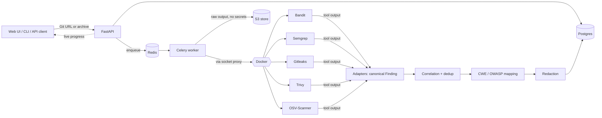

# Bulwark

**One scan, one deduplicated list of findings.** Bulwark runs five open-source security scanners against
a repository, merges what they agree on, and shows you a single list you can actually work through.

> Status: pre-alpha. Weeks 1-7 of the plan are done (scanners, correlation, API, UI, CWE/OWASP mapping).
> Risk ranking with EPSS and CISA KEV is next (Week 9). Not ready for untrusted multi-user hosting yet:
> auth is a single shared token (see [Limits](#limits)).

## The problem

Every scanner covers a different slice, so you run several, and then drown. A single SQL injection shows
up as a Bandit finding, a Semgrep finding and a CWE entry; one vulnerable npm package appears in Trivy
*and* OSV-Scanner, each with its own severity. Bulwark treats the pile as one problem:

1. **Run** [Bandit](https://github.com/PyCQA/bandit), [Semgrep CE](https://github.com/semgrep/semgrep),
   [Gitleaks](https://github.com/gitleaks/gitleaks), [Trivy](https://github.com/aquasecurity/trivy) and
   [OSV-Scanner](https://github.com/google/osv-scanner), each in a locked-down container.
2. **Normalize** every result into one `Finding` schema.
3. **Correlate**: merge duplicates across tools (same dependency + shared advisory id; same file, weakness
   family and code within a few lines), keep every tool's evidence, take the highest severity.
4. **Map** each finding to its CWE and [OWASP Top 10:2021](docs/taxonomy.md) category.
5. **Show** it in a web UI, API, CLI or JSON.

## Architecture



Scanners never see the network or the host: each runs with `--network=none --read-only --cap-drop=ALL
--user=10001 --memory=2g --pids-limit=256` and the target mounted read-only. Design decisions are recorded
as [ADRs](docs/adr/) (correlation: [ADR-004](docs/adr/0004-fingerprinting-and-correlation.md)).

## Quickstart

Needs Docker (with Compose) running. The first build downloads scanner databases (about 1.4 GB for Trivy).

```bash
./scripts/init-env.sh                       # writes .env with random secrets
docker compose --profile scanners build     # app image + the custom scanner images
docker compose up -d
```

Open **http://localhost:3000**. The first page is a real sample report, no sign-in needed. To scan your own
code, go to **/app**, paste the API token from `.env` (`BULWARK_API_TOKEN`) and submit a Git URL or archive.

Prefer the command line?

```bash
pip install -e ".[dev]"
bulwark scan https://github.com/OWASP/NodeGoat
```

## Results so far

Cross-tool deduplication over five public repositories (details and caveats in
[benchmarks/README.md](benchmarks/README.md); design in [ADR-004](docs/adr/0004-fingerprinting-and-correlation.md)):

| Repository | Languages | Raw findings | Unique findings | Dedup rate | Merged across tools | Wall time |
|---|---|---:|---:|---:|---:|---:|
| VAmPI | python | 23 | 21 | **8.7%** | 2 | 40s |
| NodeGoat | javascript | 771 | 463 | **40.0%** | 291 | 78s |
| nodejs-goof | javascript | 601 | 305 | **49.2%** | 284 | 24s |
| Vulnerable-Flask-App | javascript, python | 212 | 155 | **26.9%** | 48 | 89s |
| terragoat | Terraform / Docker | 945 | 880 | **6.9%** | 65 | 224s |
| **All 5** | | **2552** | **1824** | **28.5%** | | |

Measured 2026-09-25. This measures duplicate reduction, not accuracy; precision/recall benchmarks come in Phase 6.


## Limits

- One shared bearer token: no users, roles or rate limiting yet.
- The worker reaches Docker through a socket proxy; that reduces but does not remove the risk
  ([ADR-002](docs/adr/0002-docker-isolation-strategy.md)).
- Semgrep's community rules may not be redistributed or offered as a service
  ([ADR-006](docs/adr/0006-semgrep-rules-licensing.md)); fine for your own use, undecided for a public demo.
- Deduplication numbers measure duplicate reduction, not accuracy; precision/recall benchmarks come later.

License: Apache-2.0

## Running the full stack, in detail (API + worker + Postgres + Redis + object store)

```bash
./scripts/init-env.sh                       # writes .env with random secrets; creates the work dir
docker compose --profile scanners build     # builds the app image and the 4 custom scanner images
docker compose up -d
```

Open **http://localhost:3000** for the web UI (the first page is a full sample report that needs no server; the product pitch is at **/about**): paste your API token once, submit a Git URL or an
archive, watch scanners report live, then filter and sort the merged findings and open any finding for
the code, per-scanner severities and fix guidance. The UI is served with a strict per-request-nonce
CSP and renders all scanner data as text, never HTML (threat T9; covered by `web/tests/xss.test.tsx`).

The API listens on `http://127.0.0.1:8000` (interactive docs at `/docs`). Every endpoint except
`/healthz` needs `Authorization: Bearer $BULWARK_API_TOKEN` (see `.env`).

```bash
TOKEN=$(grep ^BULWARK_API_TOKEN .env | cut -d= -f2)
curl -X POST localhost:8000/scans -H "Authorization: Bearer $TOKEN" -H 'Content-Type: application/json' \
     -d '{"source": {"type": "git", "url": "https://github.com/OWASP/NodeGoat"}}'
curl -X POST localhost:8000/scans/upload -H "Authorization: Bearer $TOKEN" -F archive=@project.zip
curl localhost:8000/scans/<id>                                    -H "Authorization: Bearer $TOKEN"
curl "localhost:8000/scans/<id>/findings?severity=HIGH&limit=20"  -H "Authorization: Bearer $TOKEN"
```

Live progress: connect a WebSocket to `/scans/<id>/ws`, send `{"token": "<token>"}`, and receive
`snapshot`, `tool.finished` and `scan.finished` events. The API never scans server-side paths: only
Git URLs and uploaded archives. See [docs/api.md](docs/api.md).

Vulnerability databases are baked into the Trivy and OSV images at build time (the sandbox has no
network at run time); rebuild those images to refresh them. Semgrep's rules are fetched at build
time and are for your own internal use only: see [ADR-006](docs/adr/0006-semgrep-rules-licensing.md).

## Building the scanner images without compose

```bash
docker build -t bulwark/bandit:1.7.10 docker/bandit
docker build -t bulwark/semgrep:1.90.0 docker/semgrep
docker build -t bulwark/trivy:0.55.2 docker/trivy              # bakes in a ~1.4 GB vuln DB
docker build -t bulwark/osv-scanner:2.6.0 docker/osv-scanner   # offline DBs: PyPI, npm, Go
```

## Usage

```bash
bulwark scan ./my-project                                # directory
bulwark scan project.zip                                 # archive (zip / tar.gz), extracted safely
bulwark scan https://github.com/owner/repo               # public Git URL (github/gitlab/bitbucket)
bulwark scan ./my-project --tools bandit,trivy           # subset of tools
```

Tools run in parallel; a tool that fails or times out is reported in `tool_status` and never fails
the scan. To fan tools out to Celery workers instead of local threads:

```bash
docker run -d -p 6379:6379 redis:7-alpine
celery -A core.tasks worker -P threads -c 5     # threads: work is subprocess-bound
bulwark scan ./my-project --distributed
```

Gitleaks uses the upstream image. Semgrep's rules are fetched at build time and are for your own
internal use only — see [ADR-006](docs/adr/0006-semgrep-rules-licensing.md).

## Web UI development

The `/about` page uses a scroll-driven section stack (each section pins while the next slides over it).
It is disabled under `prefers-reduced-motion` and below 961px, where sections simply flow; the geometry
lives in `web/lib/stack.ts` and is unit-tested.


```bash
cd web && npm ci
npm run dev          # http://localhost:3000, expects the API on :8000 (NEXT_PUBLIC_API_URL)
npm test && npm run typecheck && npm run build
```

## Commit convention

Commits follow [Conventional Commits](https://www.conventionalcommits.org) (`feat:`, `fix:`, `perf:`,
`docs:`, `chore:`, ...); the changelog and version numbers are generated from them. CI lints the
commits of every pull request against `.commitlintrc.json`. To check locally:

```bash
npx --yes -p @commitlint/cli -p @commitlint/config-conventional commitlint --from origin/main
```
