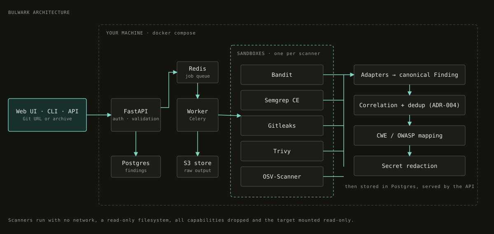

# Architecture

A scan is six steps, in order:

1. **Run.** Each scanner ([Bandit](https://github.com/PyCQA/bandit),
   [Semgrep CE](https://github.com/semgrep/semgrep), [Gitleaks](https://github.com/gitleaks/gitleaks),
   [Trivy](https://github.com/aquasecurity/trivy), [OSV-Scanner](https://github.com/google/osv-scanner),
   and any [third-party plugin](../plugins.md) an organization has allowlisted) runs in its own
   container: `--network=none --read-only --cap-drop=ALL --user=10001 --memory=2g --pids-limit=256`,
   with the target repository mounted read-only. A scanner never sees the network or the host, and
   never sees another scanner's output.
2. **Normalize.** Every tool's own output format is parsed into one canonical `Finding` --
   `core/models/finding.py` -- with a location, a taxonomy, a native severity and a fingerprint.
   Adding a new built-in scanner is "one `ToolAdapter` subclass", not a new pipeline.
3. **Correlate.** Findings that are really the same underlying issue, reported by more than one
   tool, are merged: the same dependency plus a shared advisory id (SCA), or the same file, weakness
   family and nearby lines (SAST). Every contributing tool's evidence is kept; the highest severity
   among them wins.
4. **Map.** Each finding is mapped to its CWE(s) and OWASP Top 10:2021 category.
5. **Rank.** A 0-100 risk score combines severity with [EPSS](https://www.first.org/epss/) (the
   probability of real-world exploitation in the next 30 days), CISA's Known Exploited
   Vulnerabilities list, and, for Python/JavaScript dependencies, whether the vulnerable package is
   actually imported.
6. **Show and export.** Web UI, API, CLI, and downloadable SARIF, HTML and PDF reports -- all reading
   the same stored findings, none of them a separate code path that could disagree with the others.

## Why findings are redacted before they're ever stored

A scanner's own output can itself leak a secret -- Bandit's hardcoded-credential rules (B105-B107)
echo the offending source line in their message, for instance. Every adapter either redacts at the
source or has its output passed through `core/redact.py`, which withholds the snippet and scrubs
quoted literals for anything near a detected secret, before a `Finding` is ever written to storage.

## Tenancy

Every persisted row that belongs to an organization is additionally protected by Postgres
row-level security with `FORCE ROW LEVEL SECURITY` -- not just an application-level `WHERE org_id =
...` that a future query could forget. This is the same pattern used for issues, retention settings,
the plugin allowlist and integration credentials alike.

## See also

- [Risk scoring](../risk-score.md) -- exactly how the 0-100 score and its EPSS/KEV/reachability
  inputs combine.
- [Taxonomy](../taxonomy.md) -- how a finding's CWE maps to an OWASP Top 10:2021 category.
- [Reachability](../reachability.md) -- what "reachable" means for a dependency finding, and its
  limits.
- [Writing a plugin](../plugins.md) -- adding a scanner outside this list, without forking Bulwark.
